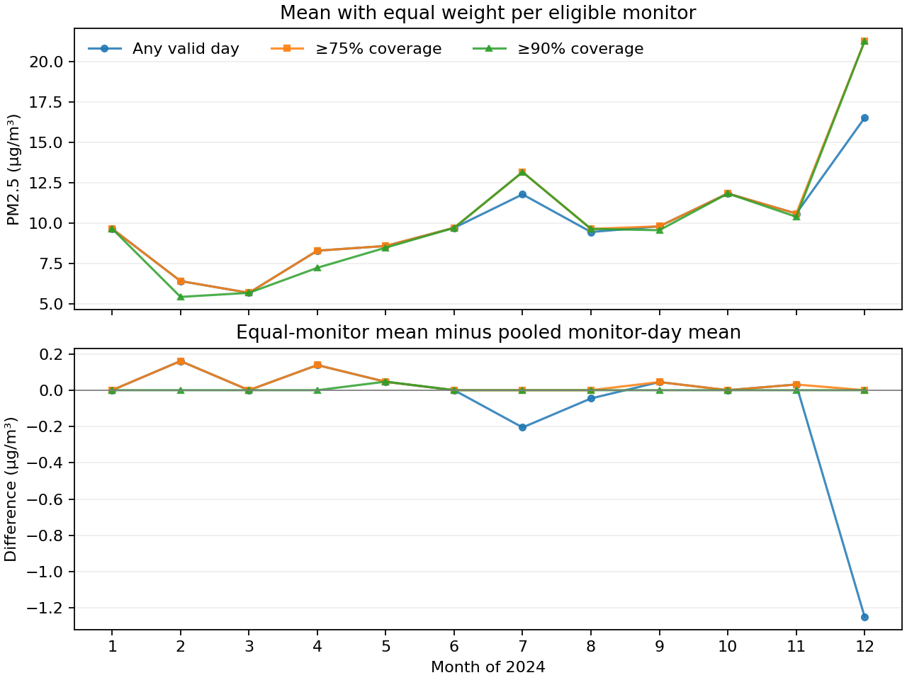

# PM2.5 Data Quality Audit

How much does a monthly PM2.5 estimate change when a monitor has incomplete observations? In December 2024, a 75% valid-day coverage rule excluded one of four Los Angeles County monitors and raised their equal-weight mean from **16.52 to 21.26 µg/m³**. The study audits 1,424 reported monitor-days, with 1,398 passing daily quality checks. Pandas and separate SQLite queries reproduce the monthly estimates from the same frozen EPA extract.



## Reproduce locally

From the repository root, use Python 3.12 and uv.

```sh
uv sync --locked
uv run --locked python audit.py
sha256sum -c checksums.sha256
uv run --locked pytest -q
uv run --locked python figure.py
uv run --locked jupyter nbconvert --to notebook --execute study.ipynb --output /tmp/pm25-executed.ipynb
```

After environment setup, add `--offline` to uv for offline reproduction. The analysis reads the committed [input and provenance](data/README.md). The CLI checks agreement before replacing the three result tables. The notebook reruns the audit in a temporary directory.

## Research materials

- [Prespecified protocol](PROTOCOL.md) and [scientific report](REPORT.md)
- [Executable notebook](study.ipynb) and [independent reference queries](reference.sql)
- [Monitor coverage](results/monitor_months.csv), [monthly estimates and included IDs](results/monthly.csv) and [weighting and eligibility contrasts](results/audit.csv)
- [Software citation](CITATION.cff) and [license](LICENSE)
