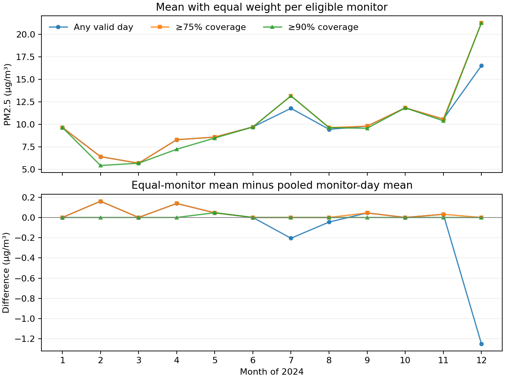

# Coverage and aggregation sensitivity in four PM2.5 monitors

## Question and design

How do monthly data-coverage thresholds and weighting affect an estimate for four Los Angeles County monitors in 2024? We audited the daily arithmetic means of hourly PM2.5 observations in a frozen EPA AirData extract. The protocol was committed before calculation. Each unit is one monitor on one local calendar day. Monitoring sites, occurrence codes, exact product filters and the archive checksum are in the [protocol](PROTOCOL.md) and [provenance record](data/README.md).

## Methods

The complete grid has 366 days for each of four monitors. A reported daily mean was eligible if finite and based on at least 18 measurements. For each of the 48 monitor-months we divided the valid-day count by the calendar length, then applied the three prespecified rules. Within each eligible set we averaged the monitor-specific means equally and separately pooled all valid monitor-days. We report signed contrasts in µg/m³. A monitor's weight in the pooled estimate is proportional to its valid-day count. The primary calculation used pandas and the reference used SQLite queries on the same parsed input.

## Data reconciliation

| Stage or coverage rule | Monitor-months | Monitor-days | Explanation |
|---|---:|---:|---|
| Calendar grid | 48 | 1,464 | Four monitors in leap year 2024 |
| Present in the source extract | 48 | 1,424 | 40 calendar monitor-days absent |
| At least one valid day | 48 | 1,398 | 26 reported days had fewer than 18 observations; zero missing or nonfinite daily means |
| Coverage ≥75% | 44 | 1,311 | Four monitor-months excluded, accounting for 87 otherwise valid monitor-days |
| Coverage ≥90% | 39 | 1,189 | Nine monitor-months excluded, accounting for 209 otherwise valid monitor-days |

## Results

December exhibited the largest absolute shift from any valid day to ≥75% under equal monitor weighting: 16.516 to 21.259 µg/m³ (+4.744). Monitor 9035/1 contributed 21 of 31 valid days (67.7%) and averaged 2.285 µg/m³ on those days. The other three monitors each supplied all 31 days. Excluding 9035/1 changed both the number and composition of eligible monitors. With any valid day, pooling observations already gave that monitor less weight, producing 17.764 µg/m³, 1.248 above the equal-monitor estimate. After its exclusion both means were 21.259.

A stricter threshold can also lower the estimate. In April, increasing the threshold from 75% to 90% reduced the equal-monitor mean from 8.298 to 7.238 µg/m³. All month-specific eligibility sets and contrasts are in the [monthly estimates](results/monthly.csv) and [sensitivity table](results/audit.csv).

## Verification and interpretation

The independent pipelines validate monitor identities, counts, eligibility, missingness and numerical agreement to an absolute tolerance of 1e-9. SHA-256 hashes identify the extract and canonical output files. Hand-computed cases exercise leap-year coverage, boundary inclusion, duplicates, empty groups and unequal weights.

The estimands describe four instruments selected by the documented data product and location. The archive does not establish concentrations on missing days or the causes of gaps. Stricter eligibility can change which locations contribute. These descriptive differences cannot establish a preferred estimator for countywide exposure, temporal trends, health impacts or attainment of regulatory standards.

## Sources

- US Environmental Protection Agency. AirData daily summaries, 2024, PM2.5 (88101). [Download index](https://aqs.epa.gov/aqsweb/airdata/download_files.html).
- US Environmental Protection Agency. Monitor identifiers, pollutant standards and daily summaries. [AirData file documentation](https://aqs.epa.gov/aqsweb/airdata/FileFormats.html).
